<div align="center">

# PAM Web Console

**Consola web multi-tenant para operar CyberArk Privilege Cloud.**

Inventario, gestión y auditoría de accesos privilegiados de todos los clientes
desde un solo panel, con control de acceso por rol, doble aprobación en las
operaciones críticas y trazabilidad completa de cada acción.

[](https://github.com/AlexPerez7/pam-web-console/actions/workflows/ci.yml)
[](https://alexperez7.github.io/pam-web-console/)


**[Ver la demo en vivo »](https://alexperez7.github.io/pam-web-console/)**
&nbsp;·&nbsp; [Capturas](#capturas)
&nbsp;·&nbsp; [Probar con Docker](#probar-la-demo)
&nbsp;·&nbsp; [Seguridad](#seguridad)
&nbsp;·&nbsp; [Arquitectura](#arquitectura)

<br>

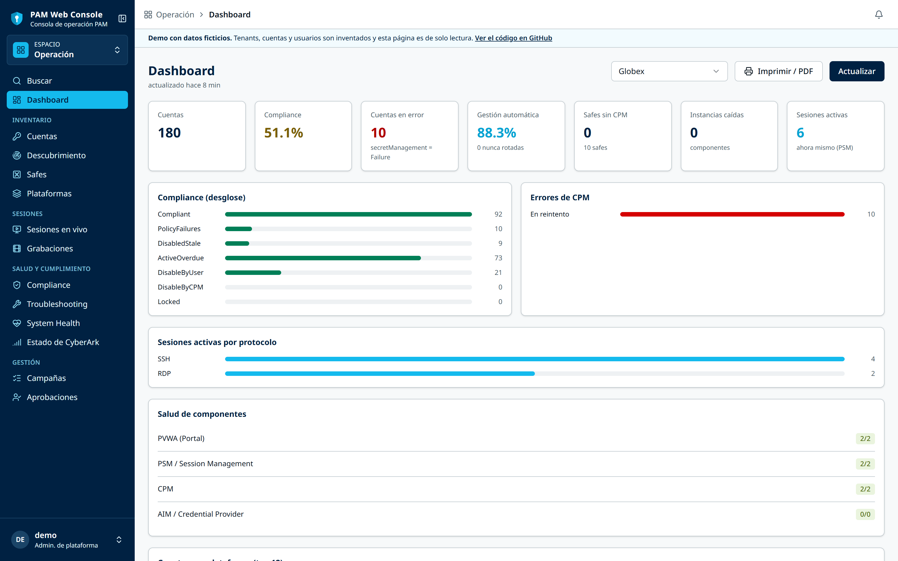

</div>

> [!NOTE]
> Proyecto real, desarrollado y usado en producción por el equipo PAM de un
> MSP. Esta es la versión pública: los datos de clientes, la infraestructura
> interna y las integraciones propias de la empresa se reemplazaron por datos
> ficticios, y se agregó un **modo demo** para probarla sin un tenant de
> CyberArk.

## El problema

El PVWA (la consola nativa de CyberArk) es una por tenant: para operar a
varios clientes hay que entrar a cada uno por separado, y las tareas
repetitivas (filtrar las cuentas de una plataforma y editarlas, buscar una
cuenta en todos los clientes, dar de alta un lote de cuentas desde un
ticket) se hacen de a una. Además, como toda acción se ejecuta con el
service account del tenant, **CyberArk no sabe qué persona del MSP hizo
cada cambio**.

PAM Web Console resuelve las dos cosas: un panel único para todos los
tenants, con flujos pensados para lo repetitivo, y un **registro de
auditoría propio**, inmutable y atribuido al operador real.

**El punto crítico no es técnico, es de riesgo:** esta herramienta puede
borrar la cuenta privilegiada de un cliente en producción. Todo el diseño
gira alrededor de contener ese radio de impacto (ver
[Principios de diseño](#principios-de-diseño)).

| | |
|---|---|
| **Para quién** | El equipo PAM de un MSP (proveedor de servicios gestionados) que administra los tenants de CyberArk de varios clientes |
| **Alcance** | CyberArk Privilege Cloud / ISPSS (PVWA, Identity, Connector Management, SIA, Remote Access) |
| **Stack** | Python 3.12 · FastAPI · SQLAlchemy 2 · PostgreSQL · Redis/ARQ · React 19 · TypeScript · Tailwind v4 · shadcn/ui |
| **Despliegue** | Docker Compose on-prem, sin dependencias de nube |

## Capturas

<table>
  <tr>
    <td width="50%" valign="top">
      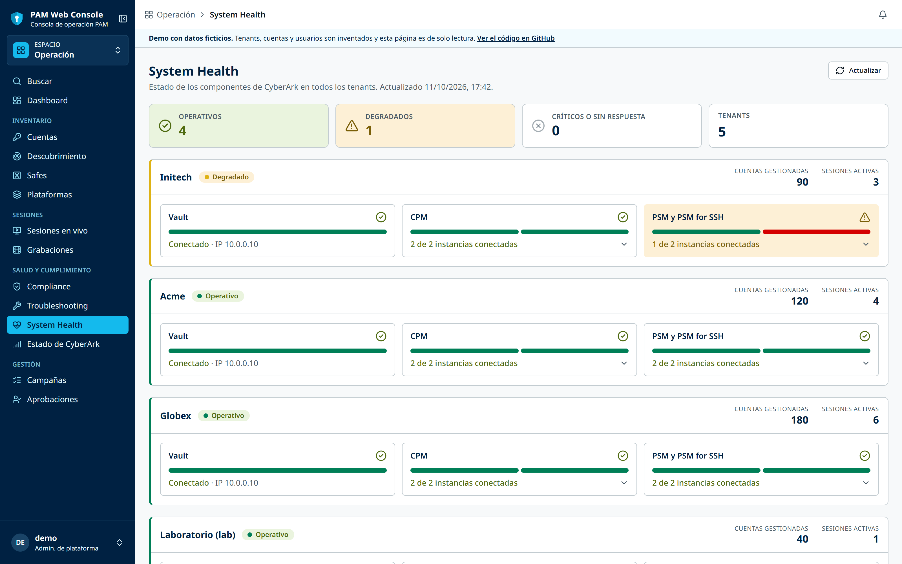
      <p align="center"><b>System Health</b><br><sub>Vault, CPM y PSM de todos los tenants en una sola vista</sub></p>
    </td>
    <td width="50%" valign="top">
      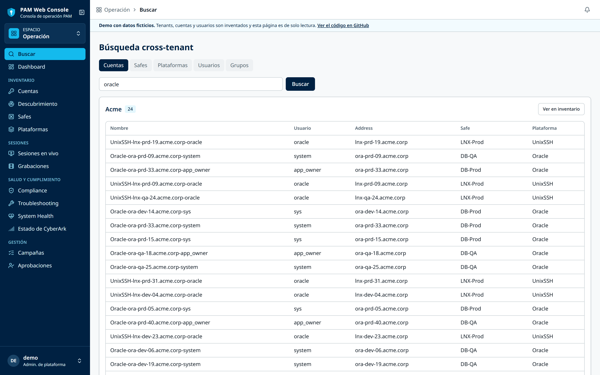
      <p align="center"><b>Búsqueda cross-tenant</b><br><sub>Cuentas, safes, plataformas, usuarios y grupos de todos los clientes a la vez</sub></p>
    </td>
  </tr>
  <tr>
    <td width="50%" valign="top">
      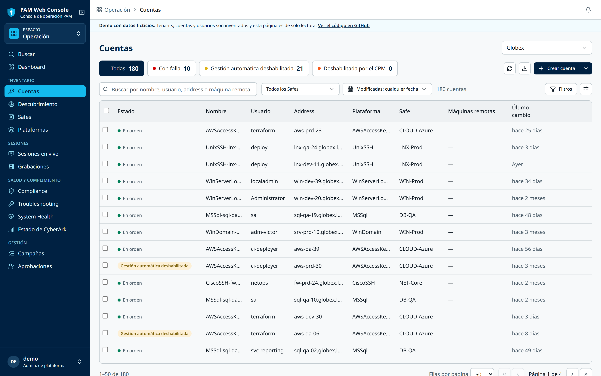
      <p align="center"><b>Inventario de cuentas</b><br><sub>Filtros server-side, selección múltiple y edición en lote</sub></p>
    </td>
    <td width="50%" valign="top">
      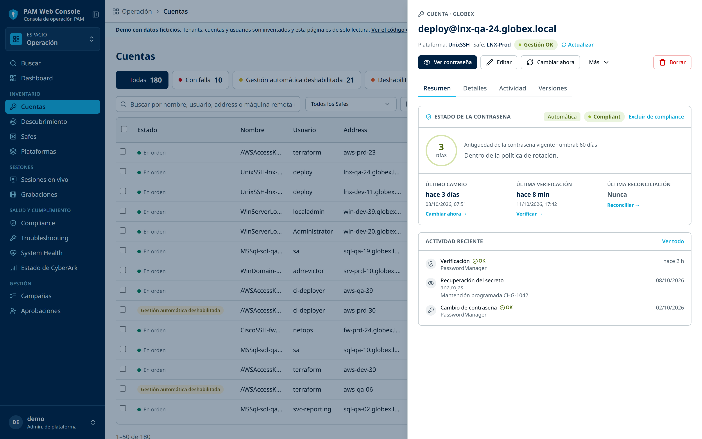
      <p align="center"><b>Detalle de cuenta</b><br><sub>Estado frente a la política de rotación, acciones del CPM y actividad</sub></p>
    </td>
  </tr>
  <tr>
    <td width="50%" valign="top">
      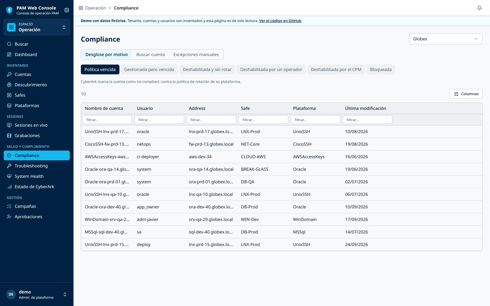
      <p align="center"><b>Compliance</b><br><sub>Desglose por motivo, cruzado con la política de cada plataforma</sub></p>
    </td>
    <td width="50%" valign="top">
      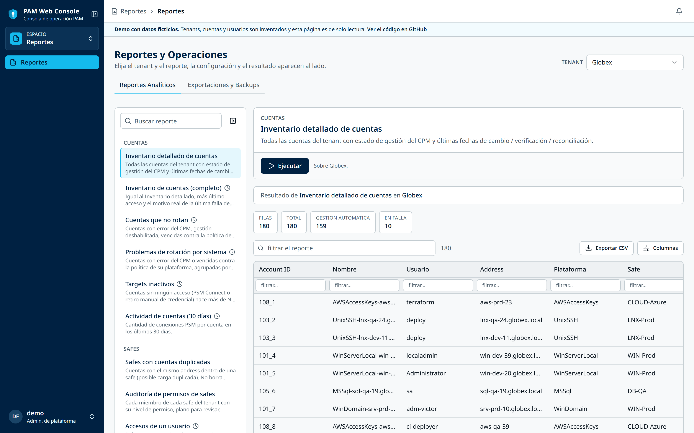
      <p align="center"><b>Reportes</b><br><sub>Catálogo ejecutable con export CSV y Excel</sub></p>
    </td>
  </tr>
  <tr>
    <td width="50%" valign="top">
      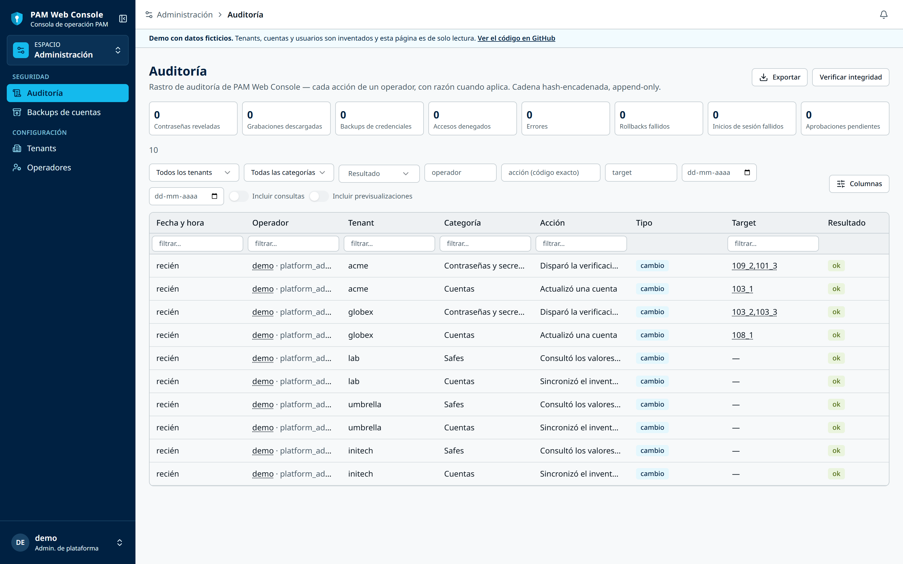
      <p align="center"><b>Auditoría</b><br><sub>Log append-only con hash encadenado y verificación de integridad</sub></p>
    </td>
    <td width="50%" valign="top">
      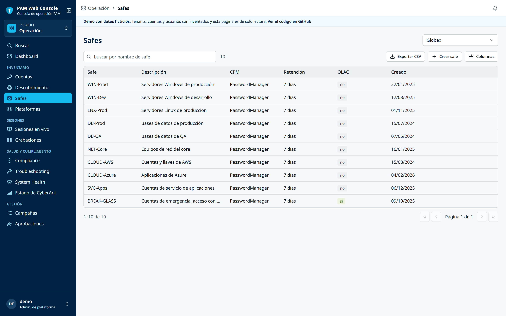
      <p align="center"><b>Safes</b><br><sub>Alta, edición y miembros, con export CSV</sub></p>
    </td>
  </tr>
</table>

## Funcionalidades

- **Inventario en vivo** de cada tenant: cuentas, safes, plataformas,
  sesiones, componentes, usuarios y grupos; paginación, orden y búsqueda
  server-side; paneles de detalle con actividad y rastro de auditoría;
  **búsqueda cross-tenant**; export CSV/PDF.
- **Dashboards** con compliance real (cruce con la política de rotación de
  cada plataforma, umbral ajustable por tenant), errores del CPM, salud de
  componentes y una página de **System Health** de todos los tenants.
- **Cuentas:** crear (wizard), editar (una o **en lote**), vincular,
  cambiar/verificar/reconciliar, fijar contraseña manual, revelar la
  contraseña, historial de versiones, borrar (con **backup cifrado** previo).
- **Alta masiva:** por CSV o **pegando el bloque del ticket**: reconoce las
  filas y completa plataforma, safe y campos por defecto.
- **Safes y plataformas:** crear/editar safes y sus miembros; activar,
  desactivar, duplicar, borrar e importar plataformas (`.zip`); ver su
  configuración completa; reasignar el PSM de una o varias plataformas.
- **Sesiones y grabaciones:** terminar sesiones activas y reproducir las
  grabaciones de PSM embebidas (decodificador propio del códec SCPR →
  ffmpeg → `<video>`).
- **Operación:** campañas de rotación/remediación, base de conocimiento de
  errores del CPM, Discovery, backup cifrado de credenciales de un tenant.
- **Identity, Remote Access (Alero), Connector Management y SIA.**
- **Reportes:** catálogo con export CSV y Excel (inventario, duplicados de
  safes, permisos, balance de PSM, candidatos a licencia, inactividad,
  cuentas que no rotan, fallas de rotación por sistema, accesos de un
  usuario) y un **reporte mensual de telemetría** en HTML por tenant.
- **Jobs y alertas:** sync nocturno del inventario a Postgres y reglas de
  alerta (componente caído, aprobación pendiente) hacia Microsoft Teams,
  con severidad, debounce y heartbeat diario.
- **Aprobación de un segundo operador** para las operaciones destructivas.

## Probar la demo

### En el navegador (sin instalar nada)

**[alexperez7.github.io/pam-web-console](https://alexperez7.github.io/pam-web-console/)**
es el frontend real compilado en modo demo: responde la API desde
respuestas reales del backend generadas con datos ficticios
(`backend/tools/export_demo_site.py`, se regenera en cada push con
`.github/workflows/pages.yml`). Se puede recorrer todo —inventario,
dashboards, System Health, búsqueda cross-tenant, reportes, auditoría— pero
es de solo lectura: las escrituras responden un aviso.

### Completa, con Docker

Con `PAM_DEMO_MODE=true` la consola corre completa —RBAC, audit log,
dry-run, aprobaciones, jobs, reportes— pero la API de CyberArk la responde
un **mock en proceso** (`backend/app/demo/`) con 5 tenants ficticios
(Globex, Acme, Initech, Umbrella y un laboratorio), cada uno con su propio
inventario determinista. Ninguna request sale a internet y no hace falta el
secret store. Las escrituras se aplican sobre un estado en memoria.

Requisitos: Docker con Compose.

```bash
git clone https://github.com/AlexPerez7/pam-web-console.git
cd pam-web-console
cp .env.example .env
# en .env: PAM_DEMO_MODE=true, POSTGRES_PASSWORD y
#          PAM_SECRET_KEY (openssl rand -hex 32)
docker compose up -d --build
docker compose exec -it api python manage.py demo-setup   # tenants + operador "demo"
```

Abra `https://localhost/` con `PAM_HTTPS_BIND=127.0.0.1` (certificado
autofirmado: el navegador muestra una advertencia) o `http://localhost:8080`.
El primer login muestra un código QR para enrolar el **TOTP obligatorio**
en cualquier app de autenticación.

## Principios de diseño

1. **Gating por rol, no por interruptor:** el único freno de una escritura
   es el rol RBAC efectivo mínimo que exige su endpoint
   (`operator+`/`approver+`/`tenant_admin+`/`platform_admin`, escalonado por
   el riesgo real de la operación).
2. **Todo se audita**, lecturas incluidas, en un log append-only con hash
   encadenado, atribuido al operador real.
3. **`dry-run` + diff** antes de cualquier escritura, con motivo obligatorio.
4. **Aprobación de un segundo operador** para lo destructivo; nadie aprueba
   lo propio.
5. **Aislamiento por tenant:** un cliente de CyberArk nuevo por request;
   credenciales, tokens y caché nunca compartidos.
6. **Mínimo privilegio** del service account de cada tenant.
7. **Tenant de laboratorio** antes de cualquier escritura contra un cliente.

### Ciclo de una escritura

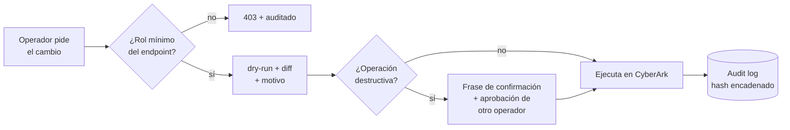

Cada paso —el intento, el dry-run, la solicitud de aprobación y la
ejecución— queda en el audit log con el operador real, el tenant, el
objeto afectado y el `before`/`after`.

## Seguridad

Registro vivo de los controles que tiene el proyecto hoy. Detalle, diseño y
registro cronológico de parches en [`docs/security.md`](docs/security.md);
modelo de amenaza y checklist completo en [`docs/PLAN.md`](docs/PLAN.md) §3
y §10.

| Área | Controles principales |
|---|---|
| **Identidad** | Argon2id · TOTP obligatorio con anti-replay · JWT de 15 min en memoria + refresh rotativo de un solo uso en cookie `HttpOnly` · anti-fuerza-bruta por usuario e IP |
| **Autorización** | RBAC deny-by-default, scopeado por tenant (`viewer < operator < approver < tenant_admin < platform_admin`) |
| **Auditoría** | Log append-only con `sha256` encadenado + trigger de Postgres que bloquea `UPDATE`/`DELETE` |
| **Multi-tenant** | Un cliente de CyberArk nuevo por tenant y por request · caché particionada, sin secretos |
| **Secretos** | Credenciales cifradas con `age`, fuera del repo · backups de credenciales con un keypair propio |
| **Radio de impacto** | Dry-run + diff + motivo · rate-limit y circuit breaker de escrituras · confirmación reforzada · doble aprobación · backup cifrado antes de borrar |
| **Red** | Nunca expuesto a internet · CSP estricta, HSTS, `X-Frame-Options: DENY` · `/docs` deshabilitado fuera de `dev` · contenedor no-root |
| **CI** | gitleaks · `pip-audit` · `npm audit` · ruff con reglas de seguridad (`S`) · mypy · axe-core (0 violaciones WCAG 2.1 AA) |

<details>
<summary><b>Checklist completo de controles</b> (✅ implementado · 🔶 parcial · ⏳ pendiente)</summary>

### Identidad y acceso de operadores

- ✅ Contraseñas con **Argon2id**; política de largo mínimo; alta y reset
  fuerzan cambio en el próximo login (`must_change_password`).
- ✅ **TOTP obligatorio** — enrolamiento en el primer login, el admin nunca
  ve el secret; un código TOTP no se puede reutilizar (anti-replay).
- ✅ **Sesión endurecida** (`docs/specs/session-hardening.md`): access token
  JWT de 15 min sólo en memoria + refresh rotativo de un solo uso en cookie
  `HttpOnly; Secure; SameSite=Strict`, con detección de reutilización
  (revoca la familia), vencimiento por inactividad (60 min), tope de 12 h y
  cierre por inactividad en la UI (30 min). Claims `iss`/`aud` verificados.
- ✅ **Revocación granular** (`Operator.token_version`): logout, cambio de
  contraseña y `reset-operator` invalidan las sesiones del operador.
- ✅ **Anti-fuerza-bruta** en `/auth/login`: lockout por `(usuario, IP)` y
  techo global por IP, con la IP real del cliente detrás de nginx. Degrada
  **abierto** si Redis no responde (decisión consciente, queda auditado).
- ✅ Hash de referencia para **timing constante** ante usuario inexistente.
- ✅ **Re-auth para zonas sensibles**: con `must_change_password` pendiente,
  todo devuelve 403 salvo `/auth/me` y `/auth/change-password`.
- ⏳ Bind LDAP contra el AD on-prem; IP allowlist / ZTNA (deployment).

### Autorización — RBAC scopeado por tenant

- ✅ **Deny-by-default**: fuera de `platform_admin` global, el acceso a un
  tenant y el rol efectivo salen sólo de `role_assignments` (fila por
  tenant, o `*` como fallback).
- ✅ Jerarquía `viewer < operator < approver < tenant_admin < platform_admin`.
- ✅ Enforcement en **todos** los `/tenants/*`; `GET /tenants` y la búsqueda
  cross-tenant devuelven sólo lo accesible.
- ✅ `/audit` restringido a `tenant_admin+` y scopeado a esos tenants.
- ⏳ Permisos del service account de CyberArk escalonados por fase y por
  cliente.

### Auditoría

- ✅ **Audit log append-only** con hash `sha256` **encadenado**;
  `verify_chain()` detecta cualquier alteración, y un **trigger de
  Postgres** bloquea `UPDATE`/`DELETE` a nivel base de datos.
- ✅ **Toda** lectura y escritura pasa por `audit.record()`, atribuida al
  **operador real** (CyberArk sólo ve el service account) — con `tenant`,
  `target`, `detail`, `result`, `source_ip`, `request_id` y, en las
  escrituras, `before`/`after`.
- ✅ Eventos de auth auditados (`auth.login`, `auth.refresh`) sin la
  contraseña ni el código TOTP.
- ✅ Página **Audit** con filtros por categoría y traducción de las acciones.
- ⏳ Export WORM + retención ≥ 2 años (deployment / política).

### Aislamiento multi-tenant

- ✅ Un **`CyberArkClient` nuevo por tenant por request** — credenciales y
  tokens de sesión **nunca** compartidos entre tenants.
- ✅ Caché **particionada por tenant**, sólo métricas agregadas y TTL corto
  (nunca secretos).
- ✅ v1 sólo opera `privilege_cloud`; `tenant_client` rechaza `self_hosted`.

### Custodia de secretos

- ✅ Credenciales de los service accounts **fuera del repo y fuera del disco
  de PAM Web Console**: `secrets/secrets.age` (cifrado con `age`), existe
  **sólo en el server**. `seed/tenants.json` lleva sólo URLs + `secret_ref`.
- ✅ Los **backups de cuentas/credenciales** se cifran con un keypair `age`
  propio, separado del secret store de tenants.
- ✅ **Guard de arranque**: fuera de `dev`, la API no arranca si
  `PAM_SECRET_KEY` es el default o tiene < 32 caracteres.
- ⏳ CCP / OpenBao self-hosted con auth por app-id + cert de cliente.

### Resiliencia y límites

- ✅ **Semáforo de concurrencia** por tenant hacia CyberArk, retry con
  backoff ante 429/5xx transitorios y re-auth ante 401.
- ✅ **Rate-limit de lecturas** por `(operador, tenant)` para no saturar el
  service account compartido de un tenant.
- ✅ Caché y logging **tolerantes a Redis caído**.

### Red y contenedores

- ✅ **Acceso directo por HTTPS en la LAN** (decisión consciente, ver
  `docs/security.md`): `:443` en la IP LAN con certificado de mkcert; `:8080`
  (HTTP) y `:8000` (API cruda) siguen atados a `127.0.0.1`. Postgres y Redis
  sin puertos publicados. **Nunca expuesto a internet.**
- ✅ `/docs`, `/redoc` y `/openapi.json` **deshabilitados fuera de `dev`**.
- ✅ Contenedor `api` como **usuario no-root** (uid 1000).
- ✅ **Headers en nginx**: `Content-Security-Policy` (`default-src 'self'`),
  `X-Content-Type-Options`, `X-Frame-Options: DENY`, `Referrer-Policy`,
  `Permissions-Policy`, **HSTS** en `:443`.
- ✅ SPA **100% self-hosted** (fuentes locales, sin requests a terceros).
- ✅ `.dockerignore` excluye `.env*`, `secrets/`, `tls/`, `*.pem/key/crt`.
- 🔶 **CA local de mkcert** para el HTTPS interno: la llave de la CA se
  respalda cifrada y sólo se distribuye el `rootCA.pem` público.
- ⏳ Escaneo de imágenes (trivy).

### Pipeline de seguridad (CI)

- ✅ **Secret scanning** con `gitleaks` (historia completa en push) +
  `.pre-commit-config.yaml`.
- ✅ **SCA** — `pip-audit` (backend) + `npm audit --omit=dev
  --audit-level=high` (frontend).
- ✅ `ruff` (lint + reglas `S`/flake8-bandit) + `mypy` + `pytest`.
- ✅ **Accesibilidad**: auditado con axe-core, 0 violaciones WCAG 2.1 AA en
  las páginas principales.

### Contención del radio de impacto

- ✅ Cada escritura exige el **rol RBAC efectivo mínimo** de su endpoint.
- ✅ `dry-run` + diff + `reason` obligatoria (≥ 8 caracteres) antes de
  ejecutar; el intento, el dry-run y la ejecución se auditan.
- ✅ **Rate-limit de escritura** por `(operador, tenant)` + **circuit
  breaker** por cantidad de objetos. El cliente CyberArk no reintenta los
  POST de creación.
- ✅ **Confirmación reforzada** (frase exacta) en las operaciones
  destructivas y **aprobación de un segundo operador**
  (`docs/specs/dual-approval.md`): quien no es `platform_admin` deja una
  solicitud pendiente que aprueba otro `approver+`; nadie aprueba lo propio.
- ✅ **Backup cifrado previo** al borrar una cuenta (individual o en lote).
- ✅ **Tenant de laboratorio** antes de tocar un cliente.
- ⏳ Snapshot de reversión automático antes de operaciones destructivas.

### Proceso (fuera de código)

- ⏳ Pentest antes de habilitar escritura en producción.
- ⏳ Backups de Postgres con restore probado como proceso.
- ⏳ Plan de respuesta a incidentes + procedimiento break-glass.
- ⏳ Revisión / aprobación de seguridad de cada cliente antes de conectar su
  tenant con permisos de escritura.

</details>

## Arquitectura

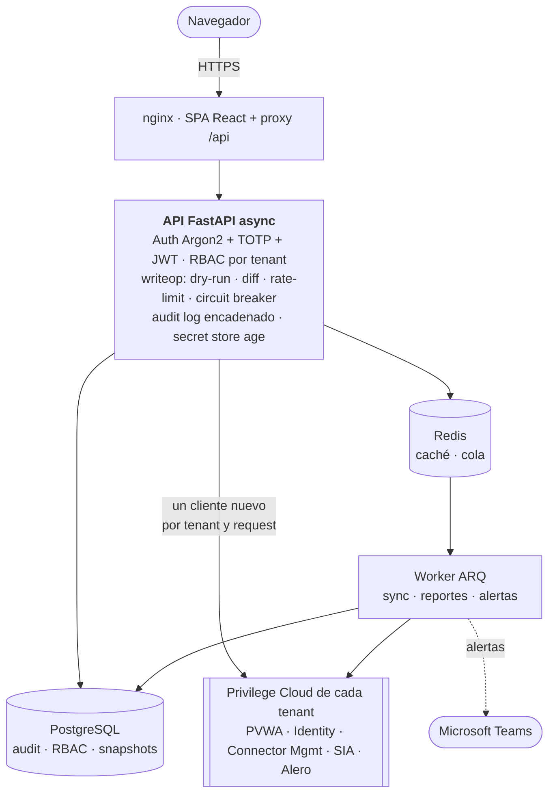

| Capa | Elección |
|---|---|
| Backend | Python 3.12 + FastAPI (async), Pydantic v2, SQLAlchemy 2.0 + Alembic |
| Cliente CyberArk | Módulo propio async (httpx): auth OAuth2 de ISPSS, retry con backoff, paginación, semáforo de concurrencia, errores tipados |
| Frontend | React 19 + TypeScript + Vite + Tailwind v4 + shadcn/ui + TanStack Query/Table |
| Base de datos | PostgreSQL 16 (trigger anti `UPDATE`/`DELETE` en el audit log) |
| Jobs | ARQ + Redis |
| Secretos | Archivo cifrado con `age`, con la interfaz lista para migrar a CyberArk CCP / OpenBao |
| Deploy | Docker Compose + systemd, on-prem |

Justificación del stack y alternativas descartadas: [`docs/PLAN.md`](docs/PLAN.md) §4.

<details>
<summary><b>Estructura del repositorio</b></summary>

```
backend/          API FastAPI async + SQLAlchemy 2 + Alembic
  app/api/          un router por área: inventory, writes, auth, approvals,
                    audit, reports, identity, alero, sia, recordings, ...
  app/core/         audit (hash chain), rbac, writeop (motor de escrituras),
                    approvals, security (Argon2/TOTP/JWT), secrets (age), ...
  app/cyberark/     cliente async de la API de CyberArk
  app/demo/         modo demo: datos ficticios + transport mock de httpx
  app/domain/       lógica pura de cada recurso
  app/jobs/         jobs ARQ: sync nocturno, reportes, alertas
  app/itr/          reporte mensual de telemetría (HTML)
  tests/            unit/ (SQLite in-memory) · contract/ (contra un tenant real)
  tools/scpr_decode decodificador C++ del códec de grabaciones de PSM
frontend/         SPA React + TypeScript
infra/            unidad systemd + script de deploy con verificaciones
docs/             PLAN · ARCHITECTURE · security · specs/ · screenshots/
```

Árbol completo con notas de diseño por módulo:
[`docs/ARCHITECTURE.md`](docs/ARCHITECTURE.md).

</details>

## Desarrollo

```bash
# backend
cd backend
python -m venv .venv && . .venv/bin/activate
pip install -r requirements.txt -r requirements-dev.txt
ruff check . && ruff format --check . && mypy && pytest

# frontend
cd frontend
npm ci
npm run lint && npx tsc --noEmit && npm run build
```

Los tests unitarios corren sin Postgres ni Redis (SQLite in-memory). Los de
`tests/contract/` pegan a un tenant real y se saltan salvo que estén las
variables `PAM_CONTRACT_*`.

CI (`.github/workflows/ci.yml`): gitleaks, ruff (incluye reglas de
seguridad `S`), mypy, pytest y `pip-audit` en el backend; eslint, tsc,
build y `npm audit` en el frontend.

**Desarrollo guiado por specs:** cada feature arrancó con una spec en
`docs/specs/` (problema, alcance, requisitos con escenarios, diseño
técnico, checklist) que se aprobó antes de escribir código; las cerradas
están en `docs/specs/done/` e incluyen lo que se encontró al probar contra
tenants reales.

## Documentación

| Documento | Para qué |
|---|---|
| [`docs/PLAN.md`](docs/PLAN.md) | Visión, riesgos, arquitectura, modelo de identidad y auditoría, roadmap |
| [`docs/ARCHITECTURE.md`](docs/ARCHITECTURE.md) | Árbol y diseño por módulo |
| [`docs/security.md`](docs/security.md) | Postura y registro de parches de seguridad |
| [`docs/specs/`](docs/specs/README.md) | Una spec por feature (`done/` = cerradas) |

## Autor

**Alex Pérez Argomedo** — diseño, desarrollo y operación del proyecto.

[](https://github.com/AlexPerez7)
